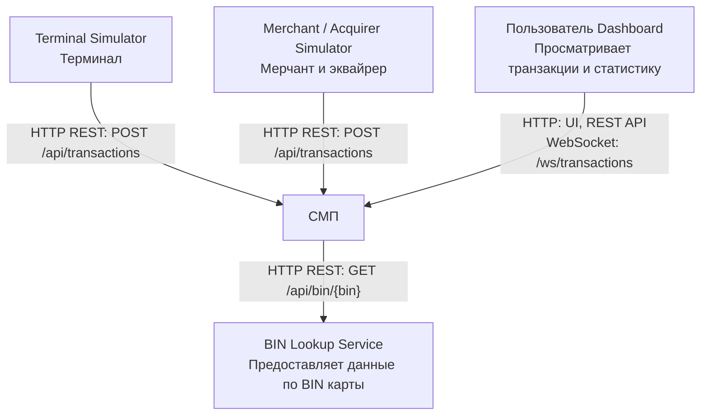

# А1. C4 Level 1 - System Context СМП

## Чего не хватало

Отдельная C4 Level 1 Context диаграмма отсутствовала.

В существующей архитектурной документации были описаны внутренние сервисы, но не была явно зафиксирована логическая граница СМП и не были собраны на одном уровне внешние участники с направлениями и протоколами связи.

## Что сделано

Создана C4 Context диаграмма, на которой СМП представлена единой системой.

Выделены внешние участники:
- Terminal Simulator
- Merchant / Acquirer Simulator
- пользователь Dashboard
- BIN Lookup Service

Для каждого взаимодействия указаны направление, протокол и конкретный эндпоинт, где это применимо.

## Подтверждение по коду

### 1. Terminal Simulator -> СМП

**Файл:**

`services/terminal-simulator/src/main/java/com/processing/terminalsimulator/client/GatewayClient.java`

Метод sendToGateway() отправляет HTTP POST-запрос на /api/transactions через RestClient.

**Вывод:** Terminal Simulator формирует тестовую транзакцию и синхронно отправляет ее в СМП.

### 2. Merchant / Acquirer Simulator -> СМП

**Файл:**

`services/merchant-acquirer/src/main/java/com/processing/merchantacquirer/client/GatewayClient.java`

Метод processAuthorize() выполняет POST-запрос на /api/transactions

**Вывод:** Merchant / Acquirer Simulator является отдельным источником транзакций и взаимодействует с СМП по HTTP REST.

### 3. Пользователь Dashboard -> СМП

**Файл:**

`services/dashboard/nginx.conf`

Конфигурация Nginx задает проксирование:
- /api/ - к Gateway;
- /ws/ - к Transaction Logger.

**Вывод:** Dashboard получает данные через HTTP API и использует WebSocket для обновлений.

### 4. Пользователь Dashboard <-> СМП (WebSocket)

**Файл:**

`services/dashboard/src/hooks/useWebSocket.ts`

Клиент устанавливает WebSocket соединение /ws/transactions для получения потока транзакций

**Вывод:** Обновления транзакций поступают в Dashboard через WebSocket.

### 5. СМП -> BIN Lookup Service

**Файл:**

`services/authorization/src/main/java/com/processing/authorization/client/BinLookupClient.java`

Метод getIssuerId() получает первые 6 символов PAN и выполняет HTTP GET-запрос /api/bin/{bin}

**Вывод:** Authorization Service синхронно обращается к BIN Lookup для получения информации по BIN карты.