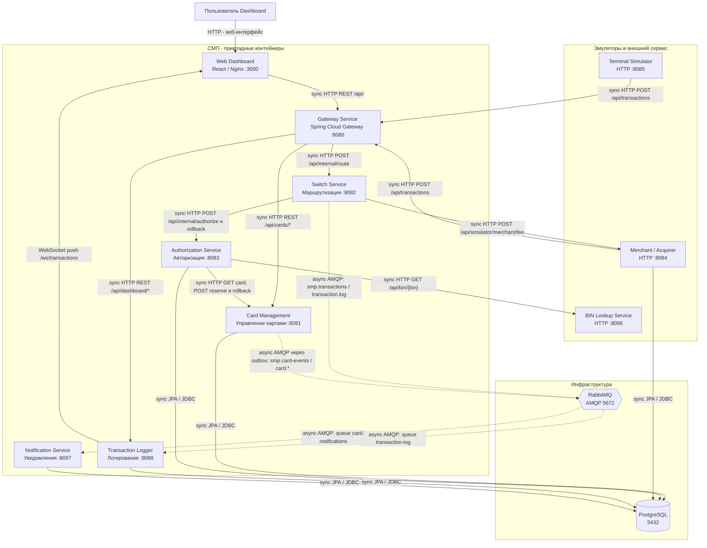

# А2. C4 Level 2 - Container

## Чего не хватало

В проекте уже существовали общая архитектурная диаграмма и Mermaid-схема, но они имели следующие недостатки:

1. Не было явного разделения синхронных и асинхронных взаимодействий
2. Не были подписаны конкретные exchange, queue и routing key RabbitMQ
3. Не был отдельно отображен outbox-механизм Card Management
4. Не была полностью показана связь Switch с Merchant Acquirer для получения комиссии
5. Не была показана прямая работа Merchant Acquirer с PostgreSQL
6. Состав сервисов не был полностью сверeн с актуальным docker-compose.yaml
7. В формулировке практики указано 11 сервисов, однако в предоставленном исходном коде и Docker Compose обнаружено 10 прикладных сервисов
## Что сделано

- Проверен фактический состав контейнеров по docker-compose.yaml
- Обозначены прикладные и инфраструктурные компоненты
- Разделены синхронные и асинхронные связи
- Указаны основные HTTP эндпоинты
- Для RabbitMQ указаны exchange, routing key и queue
- Отображен путь публикации карточных событий через outbox
- Уточнены реальные подключения к PostgreSQL

## Подтверждение по исходному коду

| Связь / компонент | Файл и подтверждение |
|---|---|
| Состав контейнеров | [docker-compose.yaml](../../../docker-compose.yaml)|
| Gateway -> Switch | [application.yml](../../../services/gateway/src/main/resources/application.yml) - маршрут `switch`, `RewritePath` |
| Gateway -> Card Management | [application.yml](../../../services/gateway/src/main/resources/application.yml) - маршрут `cards` |
| Gateway -> Logger | [application.yml](../../../services/gateway/src/main/resources/application.yml) - маршруты `logger` и `dashboard` |
| Switch -> Authorization | [AuthorizationClient.java](../../../services/switch/src/main/java/com/processing/service/AuthorizationClient.java) - `callAuthorize()` |
| Switch -> Authorization rollback | [AuthorizationClient.java](../../../services/switch/src/main/java/com/processing/service/AuthorizationClient.java) - `rollback()` |
| Маршрутизация по BIN | [RouteService.java](../../../services/switch/src/main/java/com/processing/service/RouteService.java) - `getIssuerIdByPan()` |
| Switch -> Merchant Acquirer | [MerchantAcquirerClient.java](../../../services/switch/src/main/java/com/processing/service/MerchantAcquirerClient.java) - `fetchAcquiringFee()` |
| Authorization -> Card Management | [CardManagementClientImpl.java](../../../services/authorization/src/main/java/com/processing/authorization/client/CardManagementClientImpl.java) |
| Authorization -> BIN Lookup | [BinLookupClient.java](../../../services/authorization/src/main/java/com/processing/authorization/client/BinLookupClient.java) |
| Authorization -> PostgreSQL | [LimitUsageRepository.java](../../../services/authorization/src/main/java/com/processing/authorization/repositories/LimitUsageRepository.java) |
| Card Management -> PostgreSQL | [CardRepository.java](../../../services/card-management/src/main/java/com/processing/cardmanagement/repositories/CardRepository.java) |
| Merchant Acquirer -> PostgreSQL | [AcquirerFeeRepository.java](../../../services/merchant-acquirer/src/main/java/com/processing/merchantacquirer/repository/AcquirerFeeRepository.java) |
| Switch -> RabbitMQ | [LoggerClient.java](../../../services/switch/src/main/java/com/processing/service/LoggerClient.java) - `log()` |
| Топология transaction-log | [RabbitMQConfig.java](../../../services/switch/src/main/java/com/processing/config/RabbitMQConfig.java) |
| RabbitMQ -> Logger | [TransactionLogListener.java](../../../services/transaction-logger/src/main/java/com/processing/transactionlogger/listener/TransactionLogListener.java) |
| Logger -> PostgreSQL | [TransactionRepository.java](../../../services/transaction-logger/src/main/java/com/processing/transactionlogger/repository/TransactionRepository.java) |
| Outbox -> RabbitMQ | [OutboxEventProcessorImpl.java](../../../services/card-management/src/main/java/com/processing/cardmanagement/services/OutboxEventProcessorImpl.java) |
| Обработка pending outbox | [OutboxProcessor.java](../../../services/card-management/src/main/java/com/processing/cardmanagement/services/OutboxProcessor.java) |
| RabbitMQ -> Notification | [CardEventListener.java](../../../services/notification-service/src/main/java/com/processing/notification/listener/CardEventListener.java) |
| Notification -> PostgreSQL | [CardNotificationRepository.java](../../../services/notification-service/src/main/java/com/processing/notification/repository/CardNotificationRepository.java) |
| Dashboard -> Gateway / Logger | [nginx.conf](../../../services/dashboard/nginx.conf) |
| Logger -> Dashboard (WebSocket) | [TransactionWebSocketHandler.java](../../../services/transaction-logger/src/main/java/com/processing/transactionlogger/websocket/TransactionWebSocketHandler.java) |