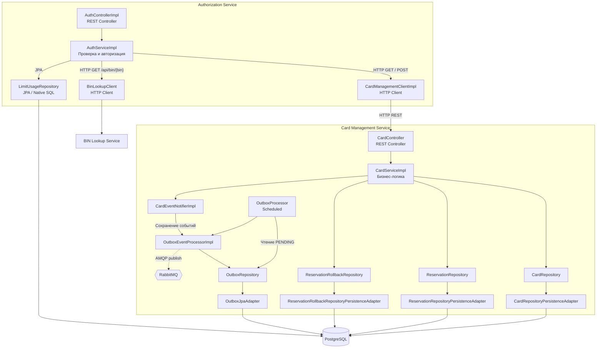

# А3. C4 Level 3 — Component

## Диаграмма компонентов Authorization и Card Management

## Чего не хватало

1. Не было диаграмм внутренней структуры Authorization и Card Management
2. Не были показаны связи Controller -> Service -> Client/Repository
3. Не была отдельно отражена работа HTTP-клиентов Authorization
4. Не был показан механизм Outbox и публикация карточных событий в RabbitMQ
5. Не были показаны адаптеры JPA и взаимодействие репозиториев с PostgreSQ.

## Что сделано

- Построены две компонентные структуры сервисов
- Отображены контроллеры, бизнес-логика, HTTP-клиенты и репозитории
- Показаны синхронные HTTP-вызовы между Authorization и Card Management
- Отображена работа с PostgreSQL через JPA
- Добавлены OutboxProcessor, OutboxEventProcessorImpl и публикация событий в RabbitMQ

## Подтверждение по исходному коду

| Компонент | Файл и подтверждение |
|---|---|
| Authorization Controller | [AuthControllerImpl.java](../../../services/authorization/src/main/java/com/processing/authorization/controller/AuthControllerImpl.java) |
| Логика авторизации | [AuthServiceImpl.java](../../../services/authorization/src/main/java/com/processing/authorization/services/AuthServiceImpl.java) - `authorize()`, `rollback()` |
| HTTP Card Management | [CardManagementClientImpl.java](../../../services/authorization/src/main/java/com/processing/authorization/client/CardManagementClientImpl.java) - `getCard()`, `reserve()`, `rollback()` |
| HTTP BIN Lookup | [BinLookupClient.java](../../../services/authorization/src/main/java/com/processing/authorization/client/BinLookupClient.java) -`getIssuerId()` |
| Лимиты и БД | [LimitUsageRepository.java](../../../services/authorization/src/main/java/com/processing/authorization/repositories/LimitUsageRepository.java) -`upsertLimitUsage()` |
| Card Management Controller | [CardController.java](../../../services/card-management/src/main/java/com/processing/cardmanagement/controllers/CardController.java) |
| Бизнес-логика карт | [CardServiceImpl.java](../../../services/card-management/src/main/java/com/processing/cardmanagement/services/CardServiceImpl.java) |
| Работа с БД | [CardRepositoryPersistenceAdapter.java](../../../services/card-management/src/main/java/com/processing/cardmanagement/repositories/CardRepositoryPersistenceAdapter.java) |
| Outbox и события | [CardEventNotifierImpl.java](../../../services/card-management/src/main/java/com/processing/cardmanagement/events/CardEventNotifierImpl.java) |
| Публикация событий | [OutboxEventProcessorImpl.java](../../../services/card-management/src/main/java/com/processing/cardmanagement/services/OutboxEventProcessorImpl.java) |
| Периодическая обработка | [OutboxProcessor.java](../../../services/card-management/src/main/java/com/processing/cardmanagement/services/OutboxProcessor.java) |