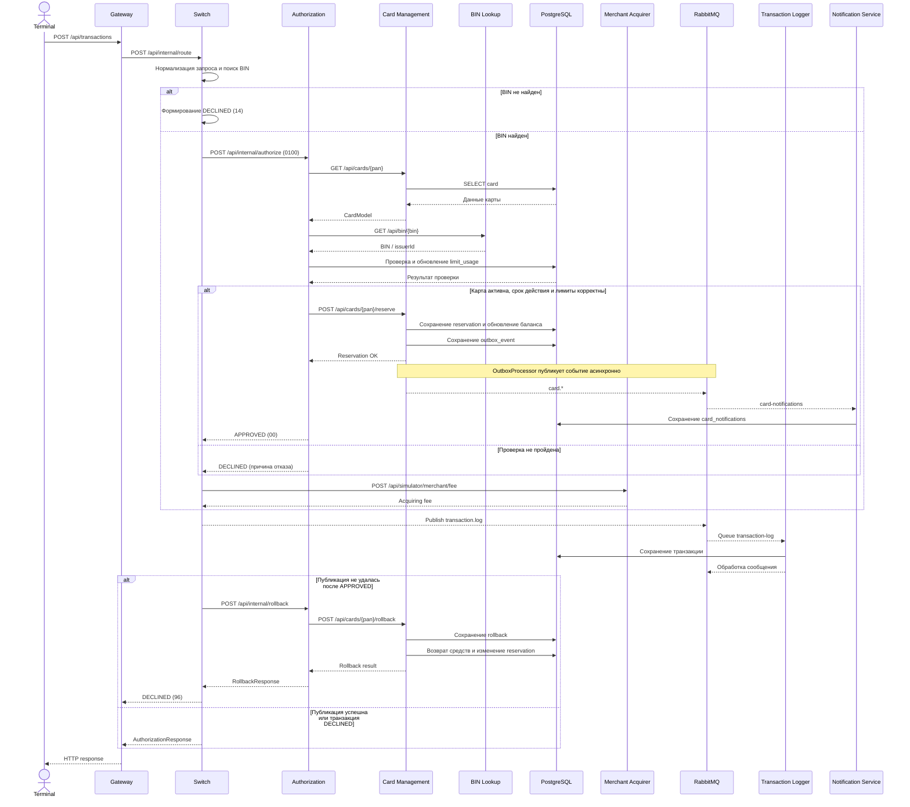

# А4. Sequence Diagram — последовательность обработки транзакции

## Диаграмма последовательности

## Чего не хватало

1. В исходной документации была только диаграмма успешного сценария.
2. Не был отражен сценарий отказа при проверке карты, баланса и лимитов.
3. Не был показан полный путь резервирования средств.
4. Не была выделена асинхронная обработка через RabbitMQ.
5. Не был отражен сценарий reversal при ошибке публикации транзакции.

## Что сделано

- Добавлен полный сценарий успешной авторизации.
- Добавлена ветка DECLINED с основными причинами отказа.
- Отображено резервирование средств через Card Management.
- Показана асинхронная отправка транзакций в Logger.
- Добавлена обработка карточных событий через Outbox и Notification Service.
- Добавлена ветка rollback при ошибке публикации сообщения.

**Особенность реализации:** в задании reversal обозначен как MTI 0400. В исходном коде есть метод AuthorizationRequest.forReversal(), но он не используется. Фактический откат реализован отдельным запросом POST /api/internal/rollback с объектом RollbackRequest. Это отражено на диаграмме.

## Подтверждение по исходному коду

| Этап | Файл и подтверждение |
|---|---|
| Gateway -> Switch | [application.yml](../../../services/gateway/src/main/resources/application.yml) — маршрут `/api/transactions` |
| Прием транзакции | [RouteController.java](../../../services/switch/src/main/java/com/processing/controller/RouteController.java) — `routeTransaction()` |
| Общая последовательность | [RouteService.java](../../../services/switch/src/main/java/com/processing/service/RouteService.java) — `route()` |
| Маршрутизация BIN | [RoutingService.java](../../../services/switch/src/main/java/com/processing/service/RoutingService.java) — `getIssuerIdByPan()` |
| Авторизация | [AuthControllerImpl.java](../../../services/authorization/src/main/java/com/processing/authorization/controller/AuthControllerImpl.java) |
| Проверки и резервирование | [AuthServiceImpl.java](../../../services/authorization/src/main/java/com/processing/authorization/services/AuthServiceImpl.java) — `authorize()` |
| Запросы к Card Management | [CardManagementClientImpl.java](../../../services/authorization/src/main/java/com/processing/authorization/client/CardManagementClientImpl.java) |
| Резервирование и rollback | [CardServiceImpl.java](../../../services/card-management/src/main/java/com/processing/cardmanagement/services/CardServiceImpl.java) |
| Публикация транзакции | [LoggerClient.java](../../../services/switch/src/main/java/com/processing/service/LoggerClient.java) — `log()` |
| Получение транзакции | [TransactionLogListener.java](../../../services/transaction-logger/src/main/java/com/processing/transactionlogger/listener/TransactionLogListener.java) |
| Обработка карточных событий | [OutboxProcessor.java](../../../services/card-management/src/main/java/com/processing/cardmanagement/services/OutboxProcessor.java) |
| Получение уведомлений | [CardEventListener.java](../../../services/notification-service/src/main/java/com/processing/notification/listener/CardEventListener.java) |
| Реализация reversal | [AuthorizationClient.java](../../../services/switch/src/main/java/com/processing/service/AuthorizationClient.java) — `rollback()` |