# А5. RabbitMQ Topology — топология сообщений

## Диаграмма RabbitMQ

```mermaid
flowchart TB
    subgraph TX["Поток транзакций"]
        SW["Switch<br/>LoggerClient"]
        TXEX{{"Topic Exchange<br/>smp.transactions"}}
        TXQ[["Queue<br/>transaction-log<br/>transaction.log"]]
        LOG["TransactionLogListener<br/>TransactionService"]
        TXDB[("PostgreSQL<br/>transactions")]

        TXDLX{{"Direct Exchange<br/>smp.transactions.dlx"}}
        TXDLQ[["DLQ<br/>transaction-log-dlq<br/>TTL 60s"]]

        SW -->|"AMQP publish"| TXEX
        TXEX --> TXQ
        TXQ --> LOG
        LOG --> TXDB
        TXQ -.->|"Dead letter"| TXDLX
        TXDLX --> TXDLQ
    end

    subgraph CARD["Поток карточных событий"]
        CMS["Card Management<br/>CardEventNotifier"]
        OUTBOX[("PostgreSQL<br/>outbox_event")]
        OP["OutboxProcessor<br/>OutboxEventProcessorImpl"]
        CEX{{"Topic Exchange<br/>smp.card-events"}}
        CQ[["Queue<br/>card-notifications<br/>card.*"]]
        NOTIF["CardEventListener"]
        NDB[("PostgreSQL<br/>card_notifications")]

        CDL{{"Direct Exchange<br/>smp.card-events.dlx"}}
        CDQ[["DLQ<br/>card-notifications-dlq<br/>TTL 60s"]]

        CMS -->|"Сохранение события"| OUTBOX
        OUTBOX --> OP
        OP -->|"AMQP publish"| CEX
        CEX --> CQ
        CQ --> NOTIF
        NOTIF --> NDB
        CQ -.->|"Dead letter"| CDL
        CDL --> CDQ
    end
```

## Чего не хватало

1. Топология RabbitMQ была описана текстом и таблицей, но отсутствовала отдельная визуальная диаграмма.
2. Не были наглядно связаны exchange, queue и consumer.
3. Не были визуализированы DLX и DLQ для двух потоков сообщений.
4. Не был показан путь карточных событий через Outbox.

## Что сделано

- Визуализированы два потока RabbitMQ: транзакции и карточные события.
- Указаны названия exchange, queue и routing key.
- Добавлены DLX и DLQ.
- Отображена публикация карточных событий через Outbox.
- Указаны параметры повторных попыток и TTL.
- Проверены настройки publisher confirms.

## Подтверждение по исходному коду

| Компонент | Файл и подтверждение |
|---|---|
| Exchange и queue транзакций | [RabbitMQConfig.java](../../../services/switch/src/main/java/com/processing/config/RabbitMQConfig.java) |
| Публикация транзакций | [LoggerClient.java](../../../services/switch/src/main/java/com/processing/service/LoggerClient.java) |
| Получение транзакций | [TransactionLogListener.java](../../../services/transaction-logger/src/main/java/com/processing/transactionlogger/listener/TransactionLogListener.java) |
| Обработка транзакций | [TransactionService.java](../../../services/transaction-logger/src/main/java/com/processing/transactionlogger/service/TransactionService.java) |
| Сохранение событий Outbox | [CardEventNotifierImpl.java](../../../services/card-management/src/main/java/com/processing/cardmanagement/events/CardEventNotifierImpl.java) |
| Периодическая обработка Outbox | [OutboxProcessor.java](../../../services/card-management/src/main/java/com/processing/cardmanagement/services/OutboxProcessor.java) |
| Публикация событий и retry | [OutboxEventProcessorImpl.java](../../../services/card-management/src/main/java/com/processing/cardmanagement/services/OutboxEventProcessorImpl.java) |
| Exchange и queue карточных событий | [RabbitMQConfig.java](../../../services/card-management/src/main/java/com/processing/cardmanagement/config/RabbitMQConfig.java) |
| Получение уведомлений | [CardEventListener.java](../../../services/notification-service/src/main/java/com/processing/notification/listener/CardEventListener.java) |
| Настройки publisher confirms | [application.yml](../../../services/switch/src/main/resources/application.yml), [application.properties](../../../services/card-management/src/main/resources/application.properties) |