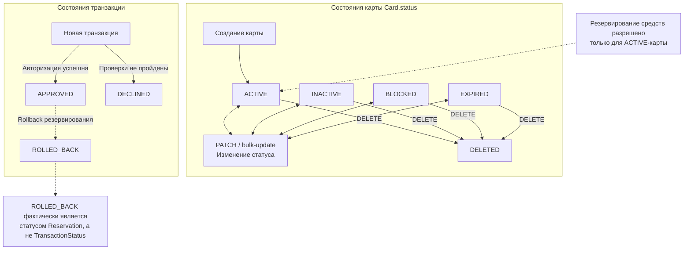

# А6. State-transition — диаграмма переходов состояний

## Диаграмма состояний карты и транзакции

## Чего не хватало

1. В проекте отсутствовала отдельная диаграмма переходов состояний карты.
2. Не были визуализированы состояния транзакции APPROVED, DECLINED и ROLLED_BACK.
3. Не были показаны условия, при которых разрешено резервирование средств.
4. Не было явно разделено состояние транзакции и состояние резервирования.

## Что сделано

- Построена диаграмма состояний карты и транзакции
- Отображены четыре основных статуса карты
- Добавлен переход в DELETED при удалении карты.
- Отображены результаты авторизации APPROVED и DECLINED.
- Добавлен сценарий rollback с переходом резервирования в ROLLED_BACK

## Подтверждение по исходному коду

| Состояние / переход | Файл и подтверждение |
|---|---|
| Статусы карты | [CardStatus.java](../../../services/card-management/src/main/java/com/processing/cardmanagement/models/CardStatus.java) |
| Создание карты | [CardServiceImpl.java](../../../services/card-management/src/main/java/com/processing/cardmanagement/services/CardServiceImpl.java) — `createCard()` |
| Изменение статуса | [CardServiceImpl.java](../../../services/card-management/src/main/java/com/processing/cardmanagement/services/CardServiceImpl.java) — `patchCard()`, `bulkUpdateStatus()` |
| Удаление карты | [Card.java](../../../services/card-management/src/main/java/com/processing/cardmanagement/models/Card.java) — `deleted()` |
| Проверка активности карты | [Card.java](../../../services/card-management/src/main/java/com/processing/cardmanagement/models/Card.java) — `checkStatusOrThrow()` |
| Статусы транзакции | [TransactionStatus.java](../../../services/common/src/main/java/com/processing/common/dto/transactionlogger/TransactionStatus.java) |
| Сохранение статуса транзакции | [Transaction.java](../../../services/transaction-logger/src/main/java/com/processing/transactionlogger/model/Transaction.java) |
| Авторизация | [AuthServiceImpl.java](../../../services/authorization/src/main/java/com/processing/authorization/services/AuthServiceImpl.java) — `authorize()` |
| Статусы резервирования | [ReservationStatus.java](../../../services/card-management/src/main/java/com/processing/cardmanagement/models/ReservationStatus.java) |
| Переход RESERVED → ROLLED_BACK | [Reservation.java](../../../services/card-management/src/main/java/com/processing/cardmanagement/models/Reservation.java) — `startRollback()`, `rolledBack()` |
| Выполнение rollback | [CardServiceImpl.java](../../../services/card-management/src/main/java/com/processing/cardmanagement/services/CardServiceImpl.java) — `rollback()` |